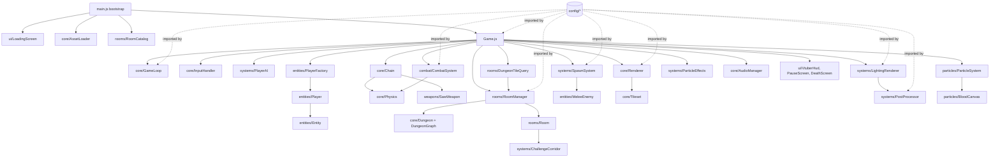

# Architecture — Dungeon Chained

Local 2-player co-op roguelike. Vanilla JS ES modules drawn on one `<canvas id="gameCanvas">`. No engine, no bundler, no npm runtime deps. Desktop build = Electron shell (`electron/main.cjs`) serving the repo through a custom `app://game/` protocol (because `fetch` of local JSON does not work over `file://`). `npm start` → `electron .`; in a browser, serve the repo root over HTTP (`map/*.json` is fetched).

Entry points: `index.html` (game, loads `js/main.js`), `editor.html` (room editor, `js/editor/EditorApp.js`, out of scope here).

## Invariant (do not break)

`js/main.js` is only a bootstrap. Never reintroduce the old monolith. New features go into a subsystem class in its own file, constructed in `Game` (`js/Game.js`) and called from `Game._step`/`Game._render`. Tuning goes in `js/config/*`.

## Boot sequence (`js/main.js` → `bootstrap()`)

1. `new LoadingScreen()` (DOM overlay `#loading-screen`), `new AssetLoader()` (constructor immediately starts every `Image` load), `new RoomCatalog()`. Unless `?skipTrailer` or `?playtest=true`: `new TrailerPlayer(canvas, assets, …)` *before* waiting, because its stage registers extra images (logo, expressions, explosion) in the loader.
2. `loading.run('Loading the dungeon…', …)`: `assets.whenReady(progress)` (weight 4) + `roomCatalog.load()` (weight 1; fetches `map/index.json` then each listed room JSON; failures only `console.warn`).
   - Trailer path: `new TrailerOverlay({ onStart: startGame, … })`, `trailer.play()`. START (end of trailer) or SKIP calls `startGame` once: `overlay.hide()`, `trailer.stop()`, then step 3. See `systems/ui.md` → Opening trailer.
3. `loading.run('Preparing the dungeon…', …)`: `game = new Game(canvas, { roomCatalog, assets })`, then `await game.audio.whenReady(4000, progress)` (4 s timeout).
4. `game.start()`: `PlayerFactory.create()` → `[p1, p2]`, `newDungeon()`, ambience loop, creates `SawMotorAudio`, `gameLoop.start()`.

## `Game` — owned subsystems (constructed in `Game` constructor)

| Field | Class | File | Role |
|---|---|---|---|
| `assets` | AssetLoader | js/core/AssetLoader.js | image registry (passed in from main) |
| `hud` | VtuberHud | js/ui/VtuberHud.js | canvas HUD: player portraits/lives |
| `deathScreen` | DeathScreen | js/ui/DeathScreen.js | DOM `#death-screen` RESTART button |
| `pauseScreen` | PauseScreen | js/ui/PauseScreen.js | DOM `#pause-screen` RESUME/RESTART/VOLUME |
| `renderer` | Renderer (+ Tileset) | js/core/Renderer.js, Tileset.js | camera, room tiles, shadows |
| `postProcessor` | PostProcessor | js/systems/PostProcessor.js | screen-space light map + vignette |
| `screenGore` | ScreenGore | js/systems/ScreenGore.js | screen blood splatter / hit flash |
| `wind` | WindSystem | js/systems/WindSystem.js | ambient dust motes |
| `bloodCanvas` | BloodCanvas | js/particles/BloodCanvas.js | persistent world-size blood layer |
| `particleSystem` | ParticleSystem | js/particles/ParticleSystem.js | sparks, dust, flames, flashes, gore |
| `audio` | AudioManager | js/core/AudioManager.js | WebAudio clips/loops/ducking (`AUDIO_CONFIG`) |
| `input` | InputHandler | js/core/InputHandler.js | keyboard + gamepad → key set |
| `playerAI` | PlayerAI | js/systems/PlayerAI.js | debug bot driving P1 (toggle `I`) |
| `chain` | Chain (wraps `[SawWeapon]`) | js/core/Chain.js, js/weapons/SawWeapon.js | cable between players + saw |
| `playerFactory` | PlayerFactory | js/entities/PlayerFactory.js | builds the 2 Players |
| `spawnSystem` | SpawnSystem | js/systems/SpawnSystem.js | builds enemies |
| `combat` | CombatSystem | js/combat/CombatSystem.js | enemy update, saw hits, deaths/gibs |
| `effects` | ParticleEffects | js/systems/ParticleEffects.js | footprints/dust per player |
| `rooms` | RoomManager | js/rooms/RoomManager.js | dungeon graph, current room, doors, clamping |
| `tiles` | DungeonTileQuery | js/rooms/DungeonTileQuery.js | hole queries, falls, safe drop/spawn points |
| `lighting` | LightingRenderer | js/systems/LightingRenderer.js | pushes lights into postProcessor |
| `gameLoop` | GameLoop | js/core/GameLoop.js | fixed-step loop, pause, hit slow-mo |
| `sawMotor` | SawMotorAudio | js/weapons/SawMotorAudio.js | created lazily in `start()` |

Also global singletons: `MasterVolume` (js/core/MasterVolume.js, localStorage key `dungeonChained.masterVolume`, `gain = v²`), `UiSound` (`setUiAudio`/`playUi`). `HeartPickup.sheet` is a static set in the Game constructor.

Debug globals: `window.audio`, `window.audioConfig`, `window.sawMotor`, `window.playerAI`, `window.trailer` (main.js, only when the trailer runs).

## Game loop (`GameLoop._tick`, rAF)

Per animation frame: `onFrameStart` (= `input.pollGamepads()`, `_pollMenuPad()`, `_updateSawMotor()`) → accumulate `frameSeconds * timeScale` (frame clamped to 0.25 s, accumulator to `SIM_STEP * MAX_SIM_STEPS_PER_FRAME`) → N × `onStep(SIM_STEP)` (`Game._step`) → one `onRender` (`Game._render`). No interpolation between steps. `timeScale` = 0 when paused, smoothstep 0.25 s ramp after resume, eased `HIT_SLOWMO` after saw hits. Most gameplay math is per-step (frames), not per-second; only intro/door-flash timers use `deltaSeconds`.

## `Game._step(dt)` state dispatch

- `gameOver` → no simulation (render continues).
- `transition` (door fade `{phase:"out"|"in", t}`, `t += TRANSITION_SPEED` per step) → `_updateTransition`; at `out` end calls `transitionThroughDoor(door)`.
- `roomIntro` (`{phase:"zoomIn"|"hold"|"zoomOut"}`) → `_updateRoomIntro`: players frozen, intro zoom, enemies spawned frozen with staggered `beginFrozenSpawn`, flame bursts.
- else `_updateGameplay`.

### `_updateGameplay` order
1. `playerAI.update()` (rewrites P1 keys if enabled) → `p1.update`, `p2.update`.
2. `_resolveFall` per player (life loss, respawn at entry spawn).
3. `effects.processPlayer`.
4. `chain.update(p1, p2, {onSnap, onReconnect, resolveDropPoint})` → `_updateSawLanding`; saw sparks / blood pickup FX.
5. `enforceSeparationLimit()` (hard cap `MAX_PLAYER_SEPARATION` while connected).
6. `room.challenge.update` + button/arrow-trap audio feedback.
7. `combat.updateEnemies`.
8. 3 iterations: `Physics.resolveEntityCollisions` + saw disc as circle obstacle; then `Physics.resolveBoxCollisions` vs `room.wallBoxes`; `enemy.ensureOnWalkableTile`.
9. `rooms.clampEnemy` / `rooms.clampPlayer` (door openings passable only when unlocked).
10. `tiles.checkHoleFalls`; first frame of fall → audio + `_dropSawOnFall` (forced chain drop).
11. `combat.resolveWeaponHits` (hit → slow-mo), `combat.resolveDeaths` (gibs, screen gore).
12. `_updateHearts` (pickup if `lives < 3`), gibs update, `effects.update`, damage detection via `p._livesSeen`, `screenGore.update`.
13. `rooms.tryClearCurrent()` → door flash, zoom punch, `hud.onRoomCleared`.
14. `particleSystem.update`, `wind.update`.
15. Death check: `p1.lives <= 0 || p2.lives <= 0` → `gameOver`, `deathScreen.show()`.
16. `_checkDoorTransition` (both players aligned and inside door depth; disabled in playtest) → `_updateCameraToCurrentRoom`.

## `Game._render()` order (verified)

World pass (inside `renderer.beginFrame()` camera transform, clipped to room rect + `DOOR_STUB_TILES`):
1. `drawBackground(BACKGROUND_TILE)` (before clip, fills view).
2. `drawRoom` (floor incl. auto-tiled holes, walls, props, torches, closed door tiles).
3. If open: `drawDoorStubs`, `drawDoorGradients`.
4. `challenge.drawFloorLayer` → `particleSystem.drawFloor` (blood canvas; masked by `tiles.darkHoleRects()`) → `effects.draw` (footprints) → `challenge.drawButtons` → `particleSystem.drawSmoke`.
5. Shadows: heart shadows, `drawRoundShadow` for p1/p2 (r 14, walk bounce) and visible enemies (r 13).
6. `chain.drawChain` (cable).
7. Depth-sorted drawables (`[p1, p2, ...enemies, ...challenge.buttonOccluders]` sorted by `y`): those with `y <= sawY` → `chain.draw` (saw) → `chain.drawDropped` → `particleSystem.drawSparks` → those with `y > sawY`.
8. `particleSystem.drawFlames` → `challenge.drawWallLayer` → `renderer.drawFrontWall` (bottom row redrawn over entities) → gibs → `challenge.drawAirLayer` → `particleSystem.drawAir` → wind if `WIND.layer === "world"`.
9. `ctx.restore()`, `renderer.endFrame()`.

Screen passes:
10. `lighting.render({...})` (queues lights into postProcessor in screen space).
11. `postProcessor.setVignetteBreath(chain strain)`, `postProcessor.draw()` (light map + vignette).
12. Hearts overlay (`beginOverlayWorld` → `heart.drawOverlay`), drawn above darkness.
13. Wind if `WIND.layer === "screen"`.
14. `_renderOverlays`: `screenGore.draw` → door transition black fade → `hud.draw`.

DOM overlays above canvas: `#death-screen` (z 40), `#pause-screen` (z 45), `#loading-screen` (z 100).

## Screens / states

`loading` (DOM, main.js) → `trailer` (main.js: `TrailerPlayer` + `TrailerOverlay`; skipped with `?skipTrailer` / `?playtest=true`) → `loading` (game audio) → `playing` (`_started = true`) ⇄ `paused` (`setPaused`; ignored before start or when gameOver; stops SFX, ambience −12 dB) → `gameOver` (any player at 0 lives; death screen) → `restart()` (floor=1, new players, `newDungeon()`). Within playing: `roomIntro` and `transition` sub-states.

Global keys (`Game._bindButtons`): `Esc` pause toggle, `T` cycle tileset variant, `R` restart (any time, no confirm), `Enter`/`Space` restart on game over. Gamepad menu (`_pollMenuPad`, any pad): Start = pause/restart, A confirm, B resume, D-pad/left stick navigate pause menu. `I` toggles PlayerAI (PlayerAI.js). Electron: F11 fullscreen, F12 DevTools. URL `?playtest=true`: uses `rooms.playtestSpawn`, disables door transitions, skips the trailer. Trailer URL flags: `?skipTrailer`, `?mute` (no audio, no gate), `?timer` (scene clock in the bottom bar).

## Where tuning lives (`js/config/`)

- `GameConfig.js`: world/grid (`TILE`, `ROOM_COLS/ROWS`, `GRID_COLS/ROWS`, `ROOM_COUNT`), sim (`SIM_HZ`, `SIM_STEP`, `MAX_SIM_STEPS_PER_FRAME`, `HIT_SLOWMO`), camera (`CAM_MARGIN`, `CAMERA_DRONE`, `ROOM_INTRO`, `TRANSITION_SPEED`), doors/spawns (`DOOR_STUB_TILES`, `DOOR_ENTER_DEPTH`, `PLAYER_DOOR_SPAWN_TILES`, `getPlayerSpawnPositions`), holes (`HOLE_TILE`, `HOLE_TILES`, `holeTileFor`, `HOLE_FALL`), lighting (`PLAYER_LIGHT_RADIUS`, `LIGHT_PIXEL_SCALE`, `TORCHES`, `DOOR_LIGHT`, `POST_PROCESSING`), `WIND`, `HAZARDS`, blood/gibs, `PROP_SCATTER`. Re-exports `AUDIO_CONFIG`, `AUDIO_CLIPS` from `AudioConfig.js`.
- `EntityConfig.js`: `playerConfigs(assets)`, enemy sprite configs, `ENEMY_TYPES`, `ENEMY_TYPE_BY_KEY`.
- `TinyRpgEnemies.js`: data for extra enemy sprite sheets (used by AssetLoader + EntityConfig).
- `AudioConfig.js`: clips, loops, mix.
- Not in config (hardcoded): Chain params in `Game` constructor; player speed/lives/invuln in `Player`; Renderer camera lerp factors.

## Module dependency rules observed

- `js/config/*` imports only other config files. Never import gameplay into config.
- `js/core/*` imports only config and other core (Chain → Physics, AudioManager → LoopVoice).
- Subsystems receive deps via a constructor options object (`{ renderer, particleSystem, audio }`) or getter closures (`getP1: () => this.p1`, `getRoom`, `isHoleAt`) instead of importing `Game`. Nothing imports `Game.js` except `main.js`.
- Cross-system calls go through `Game` (the orchestrator) or injected callbacks (`onSnap`, `resolveDropPoint`, `effects.stepBlocker`).
- `Physics` is a static utility class.

## Related docs

- `systems/players-and-chain.md` — players, chain, input, AI.
- `systems/rendering.md` — renderer, camera, tiles, assets.
- `systems/rooms-and-maps.md`, `systems/room-editor.md` — generation, pieces, editor, `serve.py`.
- `systems/combat-and-entities.md`, `systems/weapons.md` — enemies, traps, hearts, saw.
- `systems/audio.md`, `systems/visual-effects.md`, `systems/ui.md`.
- `../decisions/` — why it is built this way (ADR 0002 = subsystem architecture).
